  

  
  

  

## About me

- CS undergrad at **KMIT, Hyderabad**
- I build AI that checks its own work, and says *"I don't know"* when it can't
- Lead developer and corresponding author of **PHOENIX**, a verify-or-abstain system for financial QA *(under review, IEEE TDSC)*
- Led the team behind **Precedent**, an accounts-payable agent that learns from every invoice it resolves
- Lead Organizer, **GDG on Campus KMIT**

## Projects

### Precedent
*The accounts-payable agent that learns from every invoice exception it resolves*

Finance teams resolve the same invoice problems again and again, and the know-how sits in a few clerks' heads. Precedent checks each invoice against its purchase order and goods receipt, recalls how the team handled similar cases, and recommends a decision with those past cases as proof. Duplicate invoices, bank-detail changes, GSTIN, e-invoice IRN, new vendors and approval limits are enforced in code the AI can never override, and it only acts on its own once it has statistically earned that autonomy.

**Results:** 98% match with the clerk's decision with memory vs. 50% without · 0 wrong payments in a 26-week replay · $17 per 1,000 cases, 2.7 s median 
**Built with:** Python · FastAPI · Hindsight · Gemini · scikit-learn · React · Docker 
**Role:** Team leader · backend, AI and memory (4-member team)

[Live demo](https://precedent-ap.onrender.com) · [Code](https://github.com/Eldorado5002/Claude_Coders4)

 

### IUPMS: Smart Parking System
*Real-time parking management with computer vision and IoT*

A camera running YOLOv8 and DeepSORT detects and tracks each arriving vehicle, and PaddleOCR reads its number plate. The decision goes over MQTT to an ESP32 that opens the gate, while IR sensors track every slot and a React/Node portal shows live availability and reservations.

**Results:** 30 FPS detection · under 500 ms gate response · 6-slot hardware prototype 
**Built with:** Python · YOLOv8 · DeepSORT · PaddleOCR · ESP32 (MicroPython) · MQTT · MongoDB · React · Node.js

[Live demo](https://team99parking.onrender.com/) · [Code](https://github.com/Eldorado5002/Team99) · [Video](https://www.youtube.com/watch?v=3aC8Mt1YaYg)

 

### PHOENIX
*Evidence-grounded verify-or-abstain for financial question answering*

Language models answering questions on financial filings often return confident wrong numbers. PHOENIX answers only when every figure is tied to a quoted source in the filing and the arithmetic is recomputed exactly; otherwise it abstains instead of guessing. I also built PHOENIX-IN, a 142-question benchmark on 24 Indian annual reports.

**Results:** silent wrong answers 16.8% → 5.0% on DocFinQA (open-weight model) · caught 359 of 360 injected unsupported figures · tested on 4 benchmarks and 2 model families 
**Built with:** Python · LangGraph · Qdrant · BGE-M3 · Gemini · Nemotron 
**Status:** paper under review at IEEE TDSC · code private

## Tech stack

  

<b>AI &amp; retrieval:</b> RAG · hybrid search · cross-encoder reranking · LangGraph · Qdrant · BGE-M3 · Gemini · Vertex AI

  <picture>
    <source media="(prefers-color-scheme: dark)" srcset="https://raw.githubusercontent.com/Eldorado5002/Eldorado5002/output/github-snake-dark.svg" />
    <source media="(prefers-color-scheme: light)" srcset="https://raw.githubusercontent.com/Eldorado5002/Eldorado5002/output/github-snake.svg" />
    
  </picture>

  

